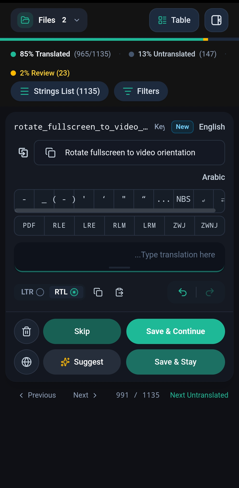
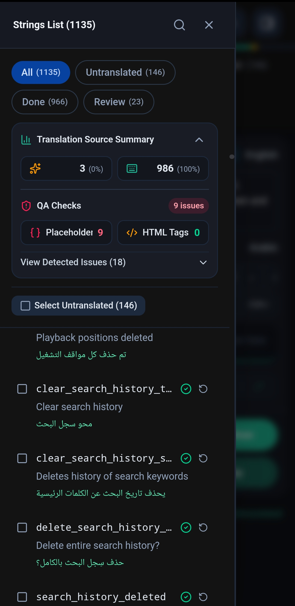
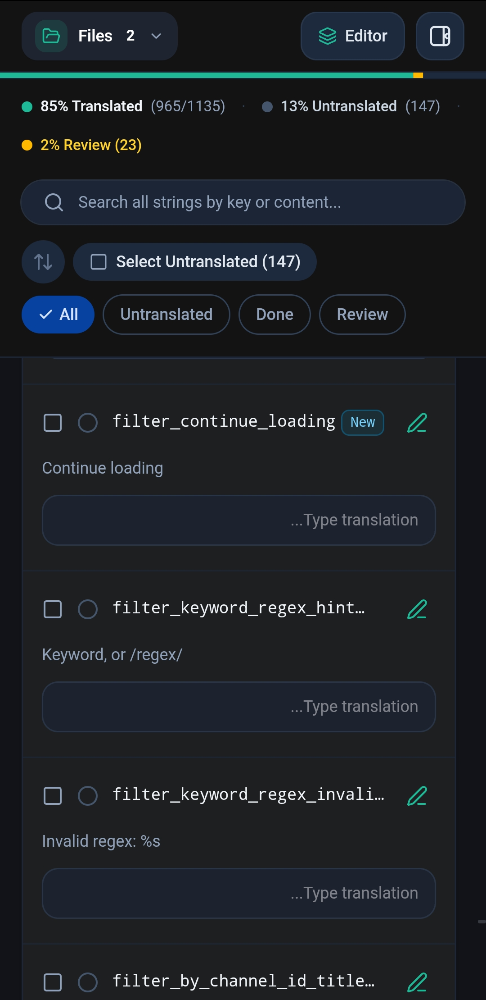
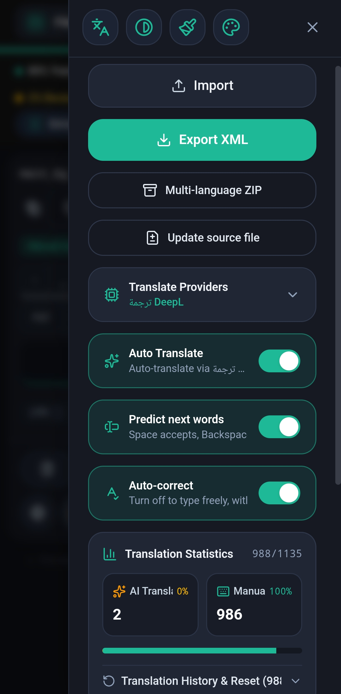
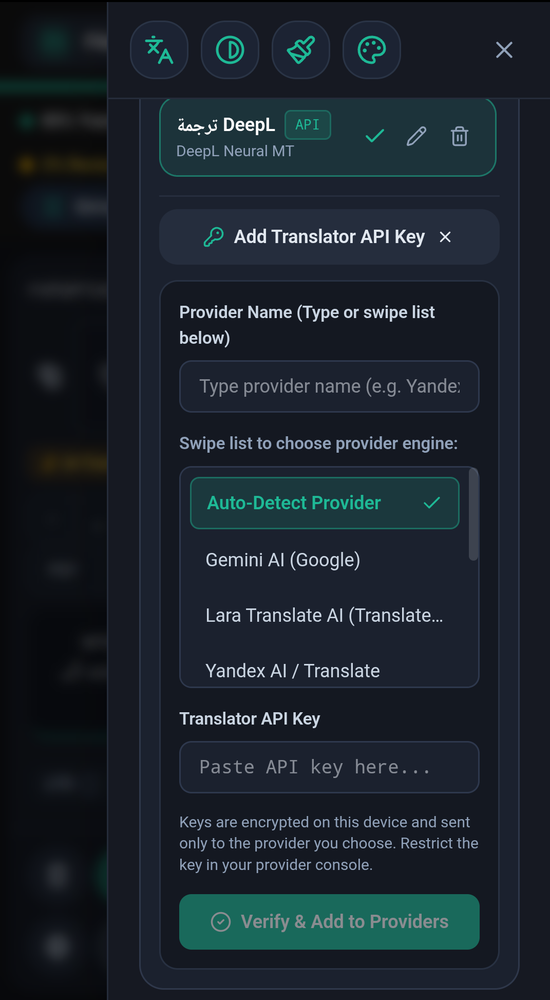
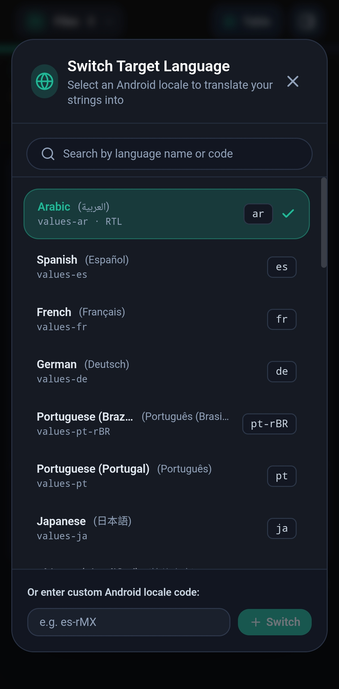
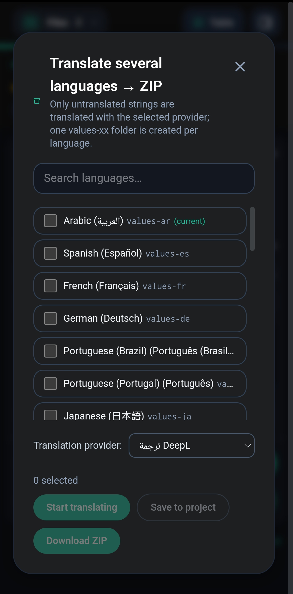
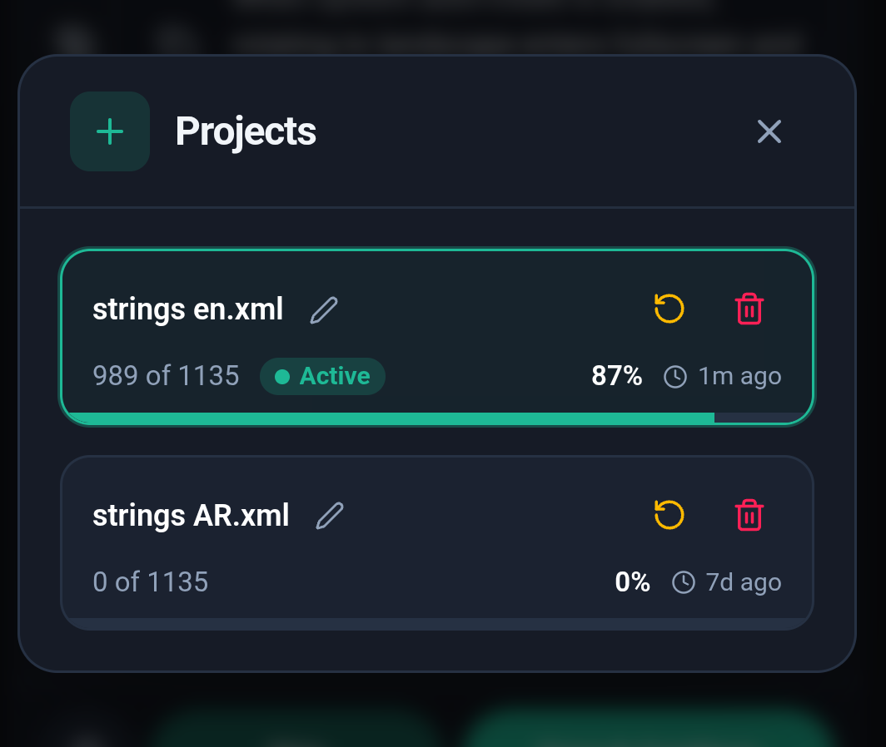

<div align="center">


# XML Translator

<a href="https://github.com/my-live-is-a-lie/strings.xml-translator/releases/latest"></a>
<br />
<a href="https://github.com/my-live-is-a-lie/strings.xml-translator/releases/latest"></a>

**Translate Android `strings.xml` files faster, safer and in your own language.**

A focused editor for Android localization — with machine translation and built-in quality checks — as a web app and a native Android app.

[](LICENSE)


</div>

<br />

<table align="center">
  <tr>
    <td width="33%"></td>
    <td width="33%"></td>
    <td width="33%"></td>
  </tr>
</table>

## Overview

XML Translator takes the `strings.xml` of an Android app, shows every string next to its source text, and helps you translate it — by hand, with a built-in glossary, or with the machine-translation provider of your choice. It checks your work as you go, so placeholders and markup survive translation, and exports a clean `strings.xml` that keeps the original structure and formatting.

It was built for translators who work from a phone as comfortably as from a desktop.

## Features

### Translation workflow
- **Focused editor** – source and translation side by side, with *Save & Continue*, *Skip*, *Suggest*, undo/redo and per-string history.
- **Strings list & table view** – jump to any string, select in bulk, sort by length, and filter by *Untranslated*, *Done* or *Review*.
- **Every resource type** – `<string>`, `<plurals>` and `<string-array>`, including language-specific plural forms.
- **Update source file** – import a newer English file and see exactly what was added, changed or removed.
- **30+ target languages** plus any custom Android locale code.
- **Your own interface language** – download the app's text as a `strings.xml`, have it translated, and upload it. Missing texts safely fall back to English.
- **Multiple projects** – keep several files side by side and switch between them instantly; progress is saved automatically.

### Machine translation, your way
- Bring your own key for **Gemini, OpenAI GPT, DeepL, Google Cloud Translate, Microsoft Azure Translator, Yandex, Lara Translate** or **LibreTranslate**.
- **Auto-detect provider** from the key you paste.
- **Offline Android glossary** for instant, consistent translations of common UI terms before any provider is called.
- **Multi-language ZIP** – translate untranslated strings into several languages at once and download one `values-xx` folder per language.
- Keys stay on your device and are only forwarded to the provider you choose.

### Quality checks
- **QA checks** for missing or altered placeholders (`%1$s`, `%d`, …) and broken HTML tags.
- **Smart typing helpers** – next-word prediction, optional auto-correct, and a double-space shortcut that closes open brackets and quotes (`( " ' ﴿ …`).
- **Quick-insert bar** for special characters and Unicode direction marks (RLM, LRM, ZWJ, NBS, …) that adapts to what you use most.
- Per-string **RTL / LTR** switch for mixed-direction text.

## Screenshots

<table>
  <tr>
    <td align="center" width="33%"><br /><sub><b>Settings & export</b></sub></td>
    <td align="center" width="33%"><br /><sub><b>Translation providers</b></sub></td>
    <td align="center" width="33%"><br /><sub><b>Target language</b></sub></td>
  </tr>
  <tr>
    <td align="center" width="33%"><br /><sub><b>Multi-language ZIP</b></sub></td>
    <td align="center" width="33%"><br /><sub><b>Projects</b></sub></td>
    <td align="center" width="33%"><br /><sub><b>Strings list & QA</b></sub></td>
  </tr>
</table>

## Built for mobile
- Native **Android app** (Capacitor) and an installable **PWA**.
- Touch-first UI: drag-to-resize action buttons, collapsing headers, lazy-loaded lists that stay smooth with thousands of strings.
- Three themes: **Day**, **Night** and **Black Hole**.

## Getting started

Requires **Node.js 22+**.

```bash
git clone https://github.com/my-live-is-a-lie/strings.xml-translator.git
cd strings.xml-translator
npm install
npm run dev        # http://localhost:3000
```

| Command | Description |
|---|---|
| `npm run dev` | Start the development server |
| `npm run build` | Production build into `dist/` |
| `npm start` | Serve the production build |
| `npm run lint` | Type-check and lint |
| `npm test` | Unit tests (Vitest) |
| `npm run test:e2e` | End-to-end tests (Playwright) |

Copy `.env.example` to `.env` for optional server settings. API keys are entered inside the app and are never stored on the server.

### Android

```bash
npm run build
npx cap add android   # first time only
npx cap sync android
npx cap open android
```

Continuous integration builds a debug APK on every push. See [RELEASE.md](RELEASE.md) for signed release builds.

## Tech stack

**React** · **TypeScript** · **Vite** · **Tailwind CSS** · **Capacitor** · **Express** · **Vitest** · **Playwright**

## Contributing

Issues and pull requests are welcome. Please run `npm run lint` and `npm test` before submitting.

## License

Distributed under the **GNU General Public License v3.0**. See [LICENSE](LICENSE) for the full text.

---

<div align="center">
  <sub>Made with care for translators everywhere.</sub>
</div>
