

# XML Translator — User Guide

Everything the app does, how to use it, and the details that are easy to miss.

[← Back to the project page](../README.md)

## Contents

1. [What it is](#1-what-it-is)
2. [Quick start](#2-quick-start)
3. [Finding your way around](#3-finding-your-way-around)
4. [The translation editor](#4-the-translation-editor)
5. [Typing helpers (the hidden details)](#5-typing-helpers-the-hidden-details)
6. [Quality checks](#6-quality-checks)
7. [Getting translations](#7-getting-translations)
8. [Organising your work](#8-organising-your-work)
9. [Updating the source file](#9-updating-the-source-file)
10. [Projects and saved work](#10-projects-and-saved-work)
11. [Exporting](#11-exporting)
12. [Plurals and arrays](#12-plurals-and-arrays)
13. [Interface, languages and themes](#13-interface-languages-and-themes)
14. [Privacy and offline use](#14-privacy-and-offline-use)
15. [Keyboard shortcuts](#15-keyboard-shortcuts)
16. [Tips](#16-tips)

---

## 1. What it is

XML Translator is an editor for Android localization files. You load the app's `strings.xml` (the English or base file), pick a target language, and translate string by string. The app keeps the structure of the original file, protects placeholders and markup while you work, and exports a clean `strings.xml` (or a ZIP with one `values-xx` folder per language) that you drop straight into your Android project.

It runs as a web app, as an installable PWA and as a native Android app. All of your work is stored on your own device.

## 2. Quick start

1. **Import** – open the import screen and choose your source `strings.xml` (usually `res/values/strings.xml`). Optionally add an **existing translation** for the target language, so you only translate what is missing.
2. **Choose the target language** – pick from 30+ Android locales (`values-ar`, `values-fr`, `values-pt-rBR`, …) or type a custom locale code such as `es-rMX`.
3. **Translate** – work in the editor, or let a provider translate for you (see [Getting translations](#7-getting-translations)).
4. **Export** – download `strings.xml` for the language, or a ZIP with several languages.

Imported files are saved automatically as soon as you edit them, so you can close the app and continue later.

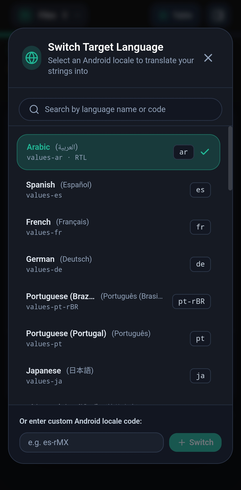

## 3. Finding your way around

| Area | What it does |
|---|---|
| **Header** | *Files* opens your projects. The *Table* / *Editor* button switches views. The side button opens the settings drawer. |
| **Progress bar & counters** | Shows translated, untranslated and *Review* percentages for the whole file. |
| **Strings List** | A side drawer with every string, its status and a one-line preview of the source and the translation. |
| **Filters** | Narrow the list by status and origin (see [Filters](#filters)). |
| **Editor** | The main workspace for one string at a time. |
| **Table view** | All strings as editable rows for fast bulk work. |

The strings list **remembers where you left it**: closing and reopening it returns to the same position.

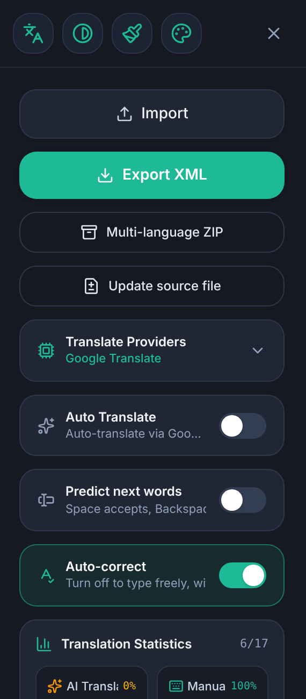

## 4. The translation editor

The editor shows the string's **key** and a *New* badge when the string is new after a source update, then the **source text** and the **translation box**.

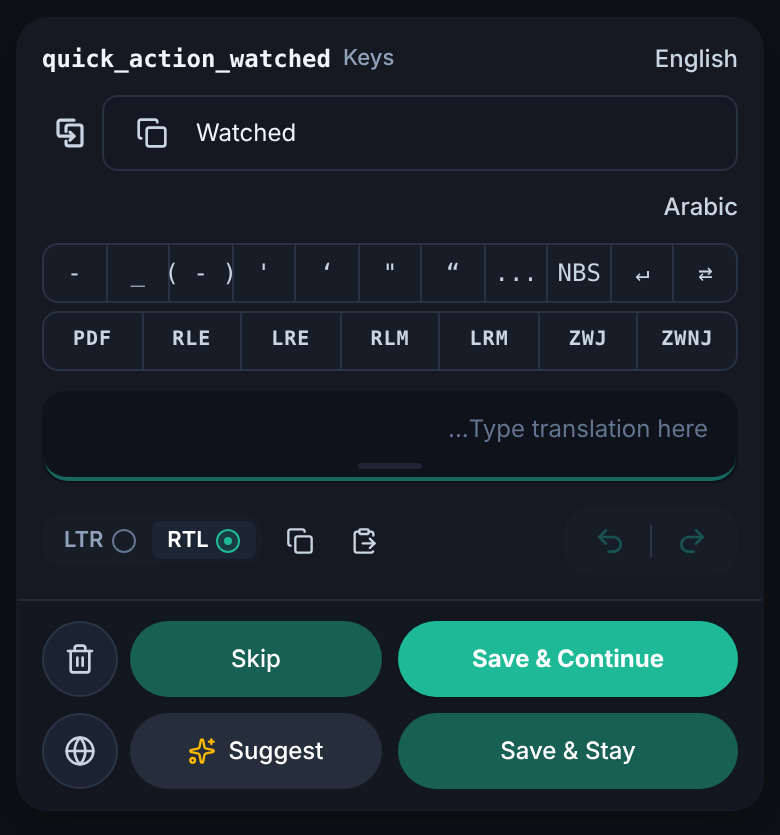

### Buttons

| Button | What it does |
|---|---|
| **Save & Continue** | Saves the translation and opens the next string. |
| **Save & Stay** | Saves and stays on the same string. |
| **Skip** | Moves on without saving. |
| **Suggest** ✨ | Fills the box with a machine suggestion (see [Suggestions](#suggestions)). Undo removes it. |
| 🗑 **Delete** | Clears the translation. |
| 🌐 **Language** | Switches the target language. |
| **Undo / Redo** | Step through your edits in this string. |
| **Copy / Paste** | Copy the source into the box, copy your text out, or paste. |
| **RTL / LTR** | Sets the text direction of the translation box for mixed-direction text. |
| **Previous / Next / Next Untranslated** | Navigation at the bottom, with a position counter such as `991 / 1135`. |

**Resizing buttons:** press and hold an action button, then drag left or right to widen it at the expense of its neighbour. The split is remembered. A plain long press without dragging still acts as a tap.

**Reset a string:** the circular-arrow button on a string resets its translation and its history.

### Translation source tracking

Every saved translation is marked as **AI** (it came from a provider or an AI app) or **manual** (you typed it). The strings list shows a small AI badge on AI translations; no badge means manual. You can filter by origin.

## 5. Typing helpers (the hidden details)

### Auto-correct

Auto-correct is **on by default** and can be switched off in the settings drawer (*Auto-correct — turn off to type freely, without warnings*).

When you press **Save**, the app compares your translation with the source and repairs what it safely can:

- **Placeholders** – missing, malformed or wrongly indexed placeholders are restored from the source. It recognises damaged copies such as `% s`, `%1 $s`, `%١$s`, `{ 0 }` or `%S`, and a placeholder with the wrong index (`%s` where the source has `%1$s`). If one is still missing it is inserted where the source has it.
- **HTML tags** – spacing and case inside simple tags are normalised (`< /b >` → `</b>`), and missing opening or closing tags and self-closing tags like ` ` are restored.
- **Final punctuation** – the ending mark and the spacing before it are made to match the source (`...` and `…` count as equal, `؟` equals `?`, and a space before a question mark is added or removed to match). Arabic-script translations use the Arabic question mark. Trailing spaces and newlines the source does not have are removed.

If anything was changed, **the save is blocked once** and a message lists what was corrected. Review the text and press **Save again** to confirm. If errors remain that could not be fixed automatically, the same happens: pressing Save a second time accepts them as they are.

With auto-correct **off**, the text is saved exactly as typed.

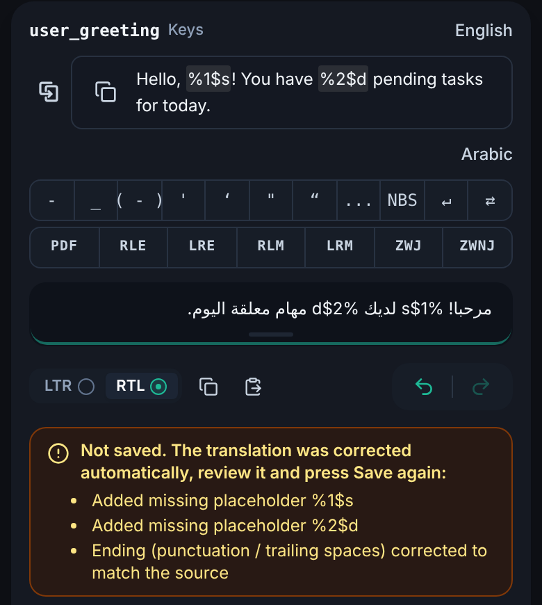

### Double space closes open symbols

If you leave a bracket or quote open and press the **space bar twice**, the app closes it for you and keeps the caret after it. It closes the **nearest unclosed** symbol before the caret.

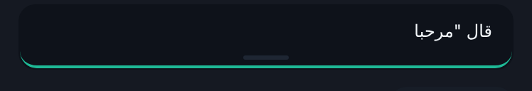 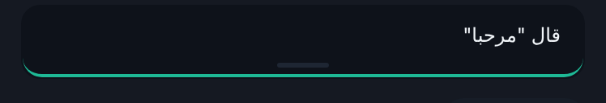

<!-- demo:double-space -->

| Opens | Closes with |
|---|---|
| `(` `[` `{` | `)` `]` `}` |
| `"` | `"` |
| `'` | `'` |
| `“` `‘` `«` `‹` | `”` `’` `»` `›` |
| `﴿` | `﴾` |

Details:
- Straight quotes `"` and `'` open and close with the same character, so an **odd** count means the last one is still open.
- An apostrophe inside a word (`don't`) is not treated as a quote, and quotes inside HTML tags (`<a href="…">`) are ignored.
- Placeholders such as `%1$s` and HTML tags are never mistaken for brackets.
- Some keyboards turn a double space into **a period plus a space**. The app detects this: when an unclosed symbol is waiting, it removes the period the keyboard added and closes the symbol instead. A period you type yourself is left alone.
- This helper follows the **Auto-correct** setting.

### Word prediction

With **Predict next words** enabled (settings drawer), the editor offers completions taken from your **own earlier translations**, so terminology stays consistent.

- Start typing a word and the first stored word that begins with what you typed is suggested. After a finished word, the stored word that followed it is suggested.
- Press **Space** to accept a suggestion and **Backspace** to reject it.
- Words you already used in the text and words you rejected are not offered again.
- Placeholders and tags count as words, so they can be completed too.

### Quick-insert bars

Two bars above the box insert characters at the caret with one tap:

- **Punctuation row:** `-` `_` `( - )` `'` `‘` `"` `“` `...` `NBS` and a line-break / tab marker.
- **Direction row:** `PDF` `RLE` `LRE` `RLM` `LRM` `ZWJ` `ZWNJ` — Unicode direction and joining marks.

The bars **learn from you**: every button you use moves toward the start of its row, following the page direction, so your most-used symbols are always closest. The usage counts are kept on your device.

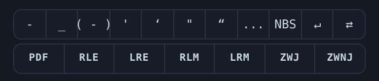

## 6. Quality checks

The **QA Checks** card in the strings list counts problems across the file and lists them under *View Detected Issues*:

- **Placeholders** – missing or mismatched format specifiers (`%s`, `%d`, `%1$s`, …).
- **HTML tags** – invalid or missing tags (`<b>`, `<i>`, `<u>`, ``, …).

Tap a counter to filter the list to just those strings. When the card is collapsed, the number of issues is shown next to its arrow. A banner also warns before export if the file contains errors that may break the app.

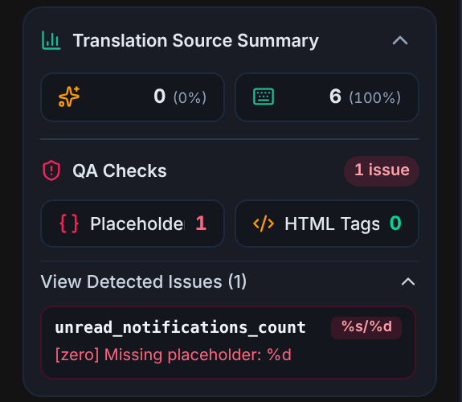

## 7. Getting translations

### Suggestions

**Suggest** translates the current string. The pipeline is:

1. **Untouched cases** – resource references (`@string/…`) and strings that are only a format token are returned as they are.
2. **Offline glossary** – an Android UI terminology glossary answers common terms instantly (also Arabic plural forms), with no network.
3. **Your selected provider** – or the free Google engine by default.

`\n`, `\\n` and tab separators are split off before translating and kept exactly as written, so line breaks are never damaged. Placeholders and tags are protected during translation and checked afterwards.

> The free Google engine uses an unofficial endpoint that can stop working without notice. If it keeps failing, the app tells you; add a provider with your own key to keep going.

### Auto Translate

The **Auto Translate** switch (settings drawer) translates each **untranslated** string automatically when you open it in the editor, using your active provider. Strings that already have a translation, and strings marked as not translatable, are left alone. Each string is only auto-translated once per visit.

### Providers

Open **Translate Providers** in the settings drawer. Supported: **Gemini, OpenAI GPT, DeepL, Google Cloud Translate, Microsoft Azure Translator, Yandex, Lara Translate, LibreTranslate** and the built-in **Google Translate**.

- Tap **Add Translator API Key**, type a name or pick an engine from the list (or *Auto-Detect Provider* to recognise it from the key), paste the key, then **Verify & Add to Providers**. The key is tested first.
- Keys are **encrypted on your device** and sent only to the provider you chose. Restrict the key in the provider's console.
- **LibreTranslate:** enter your server address (must start with `https`); the key is optional.
- **Yandex:** a service-account API key works directly; with a personal-account IAM token (starts with `t1.`, valid for at most 12 hours) a folder ID is required.
- In the Android app, key providers are called **directly from the device**; on the web they go through the app's server.
- The active provider is shown on the card. Edit or remove providers with the pencil and trash buttons.

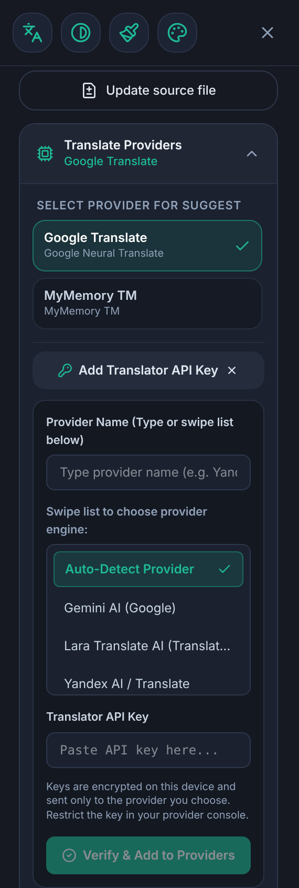

### Translate many strings at once

In the table or strings list, select strings (or tap **Select Untranslated**) and use the bulk action to translate them with a chosen provider. Strings that need review can be included optionally.

### Translate with an AI app (ChatGPT, Gemini, …)

No API key? Use any chat AI by copy and paste:

1. Choose **External AI app** and select the strings and target language.
2. Copy the generated **prompt** and the **request** (or attach the generated JSON file) in your AI app. The prompt already tells the AI to keep placeholders, tags and `\n` untouched, to answer with JSON only, and to return every `id`.
3. Paste the AI's reply (or upload its JSON file) back into the app.

The app checks every answer and reports how many came back, how many have **problems** — `missing`, `placeholder` mismatch, `same` as the source, or `empty` — and can **copy a follow-up request** covering only the missing or wrong ones. Long replies cut off mid-way are detected so you can ask the AI to continue. No API keys are ever included in what you copy.

### Multi-language ZIP

**Multi-language ZIP** translates the untranslated strings into several languages in one go and builds a ZIP with one `values-xx` folder each. Choose the languages, pick the provider, then **Start translating**, and either **Save to project** or **Download ZIP**.

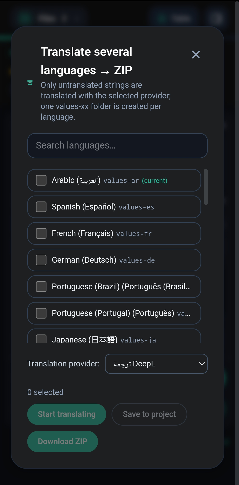

## 8. Organising your work

### Statuses

Each string is **Translated**, **Untranslated** or **Review** (needs review). After a source update, changed and new strings carry a **New** / review flag.

### Filters

Quick filters: **New**, **Review**, **Untranslated**, **Translated**, **AI**, **Manual**.

- Filters in the same group are combined with **OR** (status: Untranslated/Translated; origin: AI/Manual).
- The two groups are combined with **AND**, so *Translated + AI* shows only AI-translated strings.
- Origin filters only match translated strings.
- A filter with no matching strings cannot be switched on.
- The list is **frozen at the moment you apply a filter**: a string you just saved stays visible instead of disappearing, so you do not lose your place.

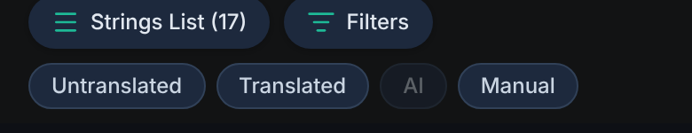

### Search, sort and selection

- **Search** matches both the key and the text.
- **Sort by length** (the arrows button in the table view) cycles through *shortest first*, *longest first* and *off*.
- **Checkboxes** select strings for bulk actions; **Select Untranslated** selects all untranslated strings in the current view.

### Strings list drawer

- Tap a string's **key line** to open it in the editor.
- Tap its **text** to expand it (source, translation and the full key); tap again to collapse. Long keys and texts are clipped to one line until expanded.
- The header collapses as you scroll down and returns as you scroll up.

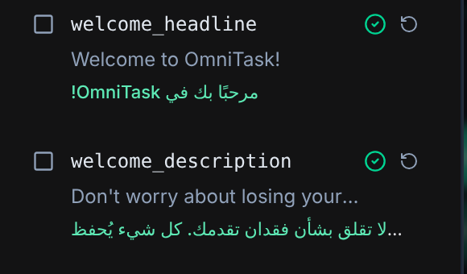 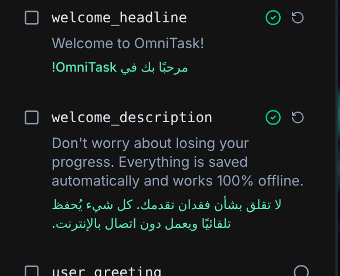

### Table view

Shows all strings as rows for quick scanning and editing. It loads strings in chunks as you scroll and unloads the ones far behind you, so very large files stay smooth.

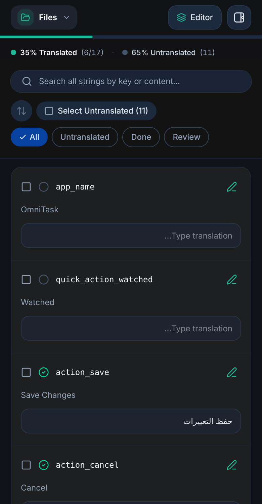

## 9. Updating the source file

When your English file changes, use **Update source file** (settings drawer) and load the newer version. Your translations are kept. The app shows a summary — *new · changed · removed · unchanged* — and a diff, and **flags changed strings for review** and new ones as *New*. Use the **New** filter to work through them.

## 10. Projects and saved work

Open **Files** to see your projects with their progress and last-modified time.

- Switch between files without losing work; every file keeps its own translations and history.
- **Rename** with the pencil, **reset** with the circular arrow, or **delete** with the trash can.
- Everything is saved automatically on your device.

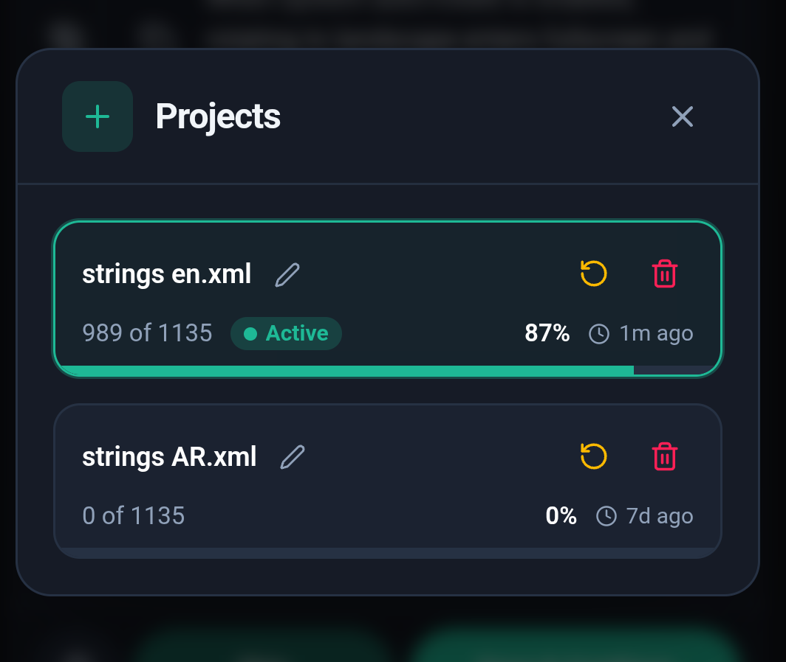

## 11. Exporting

- **Export XML** produces the `strings.xml` for the current target language, keeping the structure and indentation of your source file. A line shows how many strings are translated, for example *production-ready file (988 of 1135 translated)*.
- Optionally **export only the strings matching the active filter**.
- A warning appears if placeholder or tag errors remain.
- **Multi-language ZIP** exports several languages together.

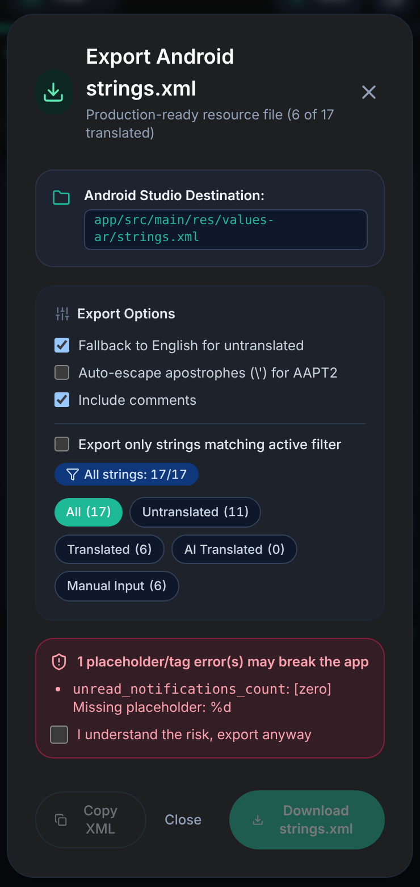

## 12. Plurals and arrays

`<plurals>` and `<string-array>` are fully supported. Plural items are shown per quantity (`zero`, `one`, `two`, `few`, `many`, `other`), and the forms are adjusted to the target language. For Arabic there is an offline glossary for plural forms.

## 13. Interface, languages and themes

- **Interface language** – switch between Arabic and English from the settings drawer.
- **Add your own interface language** – tap the **+** button next to the language tabs, download the app's text file, have it translated (for example by an AI), then upload it, type the language's name and choose its direction. Rules for the uploaded file:
  - A **deleted text** (empty between the tags) hides that explanation.
  - A button with an icon and a deleted text keeps just the icon.
  - A text-only button with a deleted text shows the English text.
  - A **removed key** falls back to English.
  - A text that is too long widens its control when possible and is clipped when there is no room.
- **Themes** – *Day*, *Night* and *Black Hole*, from the theme button in the settings drawer.

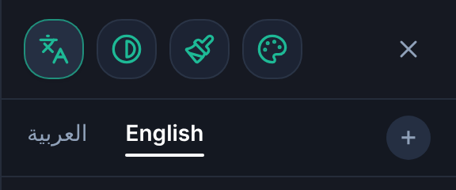 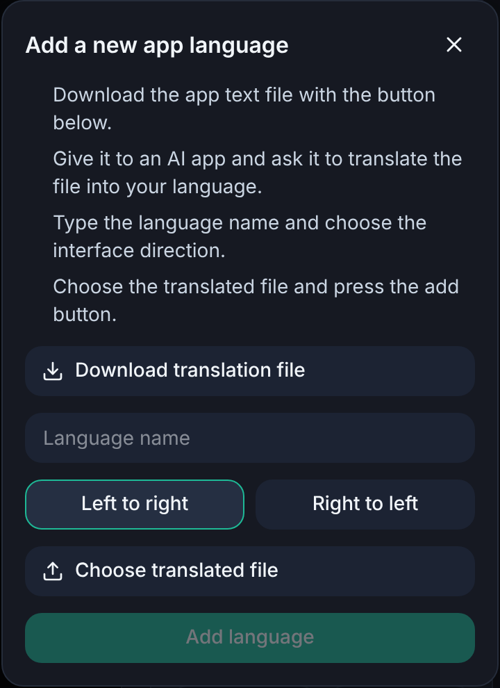

## 14. Privacy and offline use

- Your files, translations, history and settings are **stored locally** on your device.
- The app works **offline**: the glossary, editing, QA checks, import and export need no connection. Only machine translation and provider tests use the network.
- Strings are sent only to the provider or AI service **you** choose. API keys are encrypted on the device and never included in the text you copy for an AI app.
- Install the app from your browser as a **PWA** (on iPhone/iPad: *Share → Add to Home Screen*) to use it offline.

## 15. Keyboard shortcuts

| Keys | Action |
|---|---|
| `Ctrl` + `Enter` | Save and go to the next string |
| `Alt` + `→` / `←` | Next / previous string (follows the page direction) |
| `Ctrl` + `J` or `Alt` + `U` | Jump to the next untranslated string |
| `Ctrl` + `Z` | Undo |
| `Ctrl` + `Y` or `Ctrl` + `Shift` + `Z` | Redo |
| `?` | Show the shortcuts list |
| `Esc` | Close the open dialog |

## 16. Tips

- Press **Space twice** to close an opened quote or bracket instead of reaching for the symbol.
- Turn **Predict next words** on when translating a big file: it keeps your terms consistent.
- Translate the bulk with a provider, then switch to the **AI** filter to review machine translations.
- Use **Next Untranslated** (`Ctrl` + `J`) to move straight to what is left.
- After a source update, open the **New** filter first.
- Keep **Auto-correct** on while you work: it catches broken placeholders before they reach your app.
